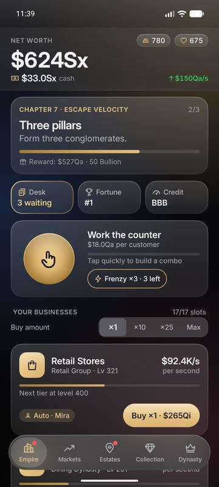
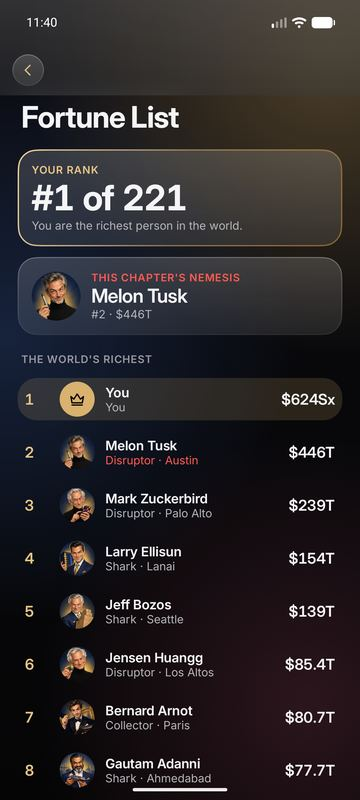
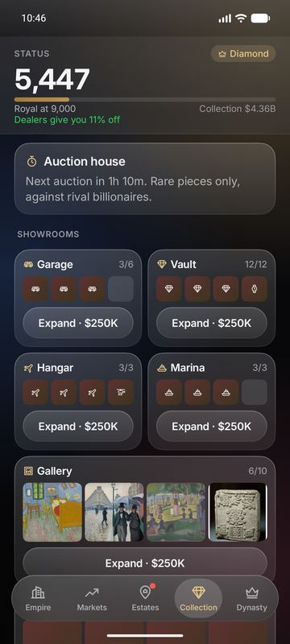
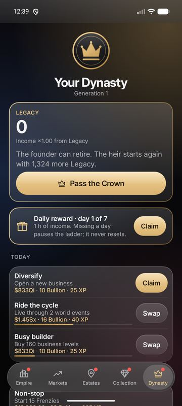
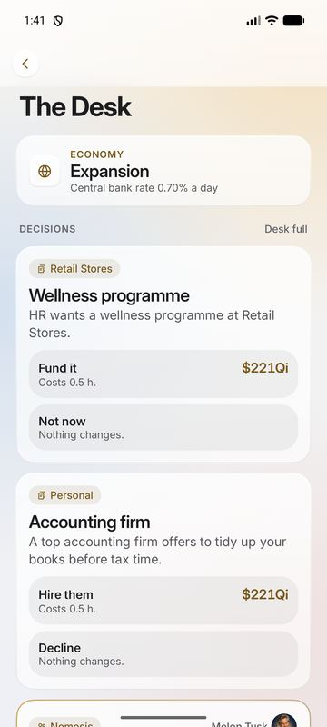

# Arnav Business Tycoon

*Build the empire. Pass on the crown.*

An original finance idle tycoon for Android by **Arnav Games**. Grow a corner kiosk in Lisbon into a multi-generational dynasty through businesses, markets, real estate, luxury collections, rival billionaires and a living world economy.

<p>





</p>

> **Store note:** every in-game purchase is a **simulated demo purchase**. No real money is ever charged and no payment details are ever requested. No ads.
>
> Company and people names are parodies of real ones and are not affiliated with them. Rival portraits are caricatures of invented people.

## Install it (friends)
1. On your Android phone (Android 9 or newer), open the [latest release](https://github.com/Arnav-Dugad/Arnav-Business-Tycoon/releases/latest) and download the `.apk` file.
2. Open the downloaded file. If Android asks, allow **Install unknown apps** for your browser or file manager (Settings → Apps → your browser → Install unknown apps).
3. Tap **Install**. To update later, install the newer `.apk` over the old one: your save is kept. The game also tells you when an update is available.

## What's in the game
- **18 businesses**, each with its own mechanic (pricing, reputation, delivery routes, drilling, film slates, launches…), managers, expansions and a merger tree up to your own holding company and IPO.
- **Markets**: 120 parody companies, funds, bonds, commodities, crypto, board seats and short selling, with news and earnings.
- **Real estate** in Lisbon, London, Miami, Mumbai, New York and Dubai: rent, renovations, mortgages, insurance, tenant decisions and skyscrapers.
- **Luxury collections**: 296 pieces including 99 real public-domain museum works, live auctions with proxy bids, showrooms and sets.
- **The Desk**: 163 decision cards with visible odds, world events and disasters, 220 rival billionaires on the Fortune List, takeovers and a nemesis in every chapter.
- **Finance**: credit score, loans, a credit line and income tax with self-filing (and audits), plus rescue options so you can never get stuck.
- **Dynasty**: 8 story chapters, then Pass the Crown. Your heir keeps Legacy (a permanent multiplier), a trait, heirlooms and a 60-node Family Charter. Daily and weekly missions, 150 achievements, seasons and a daily reward ladder.
- **Optional cloud** (when the cloud project is set up): account, cloud save with conflict protection, friends, leaderboards with fair-play ranking, weekly leagues, gifts and sealed-bid auctions.
- Works fully offline. Dark and light themes, haptics, sound effects, large-text support.

## Documentation
| Doc | Contents |
|---|---|
| [PROGRESS](docs/PROGRESS.md) | What is done, evidence, known gaps, manual steps |
| [GDD](docs/GDD.md) | Game design |
| [ECONOMY](docs/ECONOMY.md) | Formulas, pacing, balance targets, simulator |
| [ARCHITECTURE](docs/ARCHITECTURE.md) | Modules, data model, saves, sync, Firebase |
| [CONTENT](docs/CONTENT.md) | Every content category with counts |
| [ART_PIPELINE](docs/ART_PIPELINE.md) | Photo, portrait and audio sourcing and licensing |
| [TEST_PLAN](docs/TEST_PLAN.md) | Tests and release gates |

## Building from source
Requirements: JDK 21+ (Android Studio's bundled JBR works), Android SDK with platform 37, Node 20+ for the Firestore rules tests.

```bash
./gradlew :core:test :sim:test :data:test   # engine, simulator and data tests
./gradlew :app:assembleDebug                # debug APK
cd firebase && npm install && npm test      # Firestore security-rules tests (emulator)
```

Without `app/google-services.json` (never committed) a release build is the **offline edition**: all gameplay works and cloud features are hidden. Debug builds talk to the local Firebase Emulator Suite instead (`firebase emulators:start --only auth,firestore` in `firebase/`).

## License and credits
Code © Arnav Games. Fonts: Inter and Fraunces (SIL Open Font License 1.1, see [licenses/](licenses/)). Museum images: Art Institute of Chicago, CC0. Portraits: AI-generated caricatures of invented people. Sound effects: synthesized for this game. Full credits are in the app (Dynasty → Credits & licenses).
