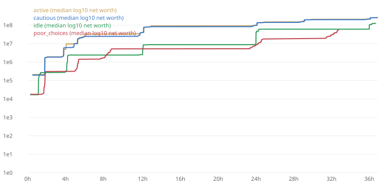

# Balance report

Commit `a4a9154+t07` · 4 bots × 100 seeds × 2 days · 505.1 s on 20 threads

Runs: 400 · errors: 0

## Targets (median real time)

| Bot | Milestone | Target | p10 | p50 | p90 | Reached | Result |
|---|---|---|---|---|---|---|---|
| active | first_level | 0.0 m–1.0 m | 1.0 m | 1.0 m | 1.0 m | 100/100 | PASS |
| idle | first_level | 0.0 m–1.0 m | 1.0 m | 1.0 m | 1.0 m | 100/100 | PASS |
| active | first_manager | 5.0 m–8.0 m | 8.0 m | 8.0 m | 8.0 m | 100/100 | PASS |
| idle | first_manager | 5.0 m–15.0 m | 10.0 m | 10.0 m | 10.0 m | 100/100 | PASS |
| active | chapter1_done | 20.0 m–35.0 m | 20.0 m | 20.0 m | 20.0 m | 100/100 | PASS |
| idle | chapter1_done | 45.0 m–1.5 h | 48.0 m | 1.1 h | 3.9 h | 100/100 | PASS |
| active | chapter2_done | 3.0 h–6.0 h | 3.3 h | 3.5 h | 3.7 h | 100/100 | PASS |
| idle | chapter2_done | 8.0 h–16.0 h | 11.4 h | 12.1 h | 12.6 h | 100/100 | PASS |
| poor_choices | chapter1_done | 0.0 m–24.0 h | 1.4 h | 1.7 h | 5.1 h | 100/100 | PASS |

## All milestones (p50, with p10–p90)

| Milestone | active | cautious | idle | poor_choices |
|---|---|---|---|---|
| first_level | 1.0 m (1.0 m–1.0 m) 100/100 | 1.0 m (1.0 m–1.0 m) 100/100 | 1.0 m (1.0 m–1.0 m) 100/100 | 1.0 m (1.0 m–1.0 m) 100/100 |
| first_manager | 8.0 m (8.0 m–8.0 m) 100/100 | 7.0 m (7.0 m–7.0 m) 100/100 | 10.0 m (10.0 m–10.0 m) 100/100 | 11.0 m (9.0 m–1.6 h) 100/100 |
| restaurant_open | 18.0 m (18.0 m–18.0 m) 100/100 | 19.0 m (19.0 m–19.0 m) 100/100 | 1.1 h (48.0 m–3.9 h) 100/100 | 1.6 h (1.4 h–5.0 h) 100/100 |
| chapter1_done | 20.0 m (20.0 m–20.0 m) 100/100 | 21.0 m (21.0 m–21.0 m) 100/100 | 1.1 h (48.0 m–3.9 h) 100/100 | 1.7 h (1.4 h–5.1 h) 100/100 |
| logistics_open | 1.5 h (1.3 h–1.7 h) 100/100 | 1.5 h (1.3 h–1.7 h) 100/100 | 1.1 h (54.0 m–3.8 h) 100/100 | 1.7 h (1.4 h–5.2 h) 100/100 |
| networth_10k | 5.0 m (5.0 m–5.0 m) 100/100 | 5.0 m (5.0 m–5.0 m) 100/100 | 6.0 m (6.0 m–6.0 m) 100/100 | 9.0 m (8.0 m–10.0 m) 100/100 |
| networth_1m | 1.5 h (1.4 h–1.7 h) 100/100 | 1.5 h (1.4 h–1.7 h) 100/100 | 4.1 h (3.8 h–11.7 h) 100/100 | 5.2 h (4.9 h–8.4 h) 100/100 |
| hq_level_5 | 1.5 h (1.3 h–1.7 h) 100/100 | 1.5 h (1.3 h–1.7 h) 100/100 | 4.0 h (3.8 h–4.2 h) 100/100 | 1.7 h (1.4 h–5.1 h) 100/100 |
| chapter2_done | 3.5 h (3.3 h–3.7 h) 100/100 | 3.5 h (3.3 h–3.7 h) 100/100 | 12.1 h (11.4 h–12.6 h) 100/100 | 8.6 h (7.5 h–31.7 h) 90/100 |
| networth_100m | 24.0 h (23.5 h–24.7 h) 100/100 | 24.0 h (23.5 h–24.7 h) 100/100 | 36.1 h (35.4 h–36.6 h) 100/100 | 32.1 h (23.9 h–32.6 h) 46/100 |
| networth_10b | — (—–—) 0/100 | — (—–—) 0/100 | — (—–—) 0/100 | — (—–—) 0/100 |

## Health

| Bot | Dead session minutes | Longest stall (p90) | Final net worth (p50) | Cash ÷ next cost (median sample) |
|---|---|---|---|---|
| active | 71.8% | 12.0 h | $262M | 1081.33 |
| cautious | 71.3% | 12.0 h | $255M | 1075.37 |
| idle | 27.0% | 12.0 h | $123M | 4.82 |
| poor_choices | 17.5% | 16.0 h | $56.0M | 1.09 |

Dead session minute = an active-session minute in which the bot found nothing worth buying. Stall = time without 1% net-worth growth.

Bots not yet simulated: `risky_trader` (needs markets, Phase 6) and `heavy_spender` (needs the store, Phase 14).
