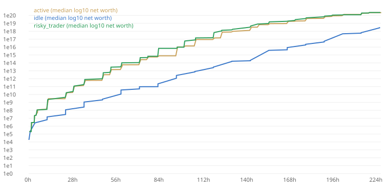

# Balance report

Commit `local` · 3 bots × 3 seeds × 10 days · 3414.8 s on 3 threads

Runs: 9 · errors: 0

## Targets (median real time)

| Bot | Milestone | Target | p10 | p50 | p90 | Reached | Result |
|---|---|---|---|---|---|---|---|
| active | first_level | 0.0 m–1.0 m | 1.0 m | 1.0 m | 1.0 m | 3/3 | PASS |
| idle | first_level | 0.0 m–1.0 m | 1.0 m | 1.0 m | 1.0 m | 3/3 | PASS |
| active | first_manager | 5.0 m–8.0 m | 7.0 m | 7.0 m | 7.0 m | 3/3 | PASS |
| idle | first_manager | 5.0 m–15.0 m | 10.0 m | 10.0 m | 10.0 m | 3/3 | PASS |
| active | chapter1_done | 20.0 m–35.0 m | 22.0 m | 22.0 m | 22.0 m | 3/3 | PASS |
| idle | chapter1_done | 45.0 m–1.5 h | 1.0 h | 1.0 h | 1.0 h | 3/3 | PASS |
| active | chapter2_done | 3.0 h–6.0 h | 3.3 h | 3.7 h | 3.7 h | 3/3 | PASS |
| idle | chapter2_done | 8.0 h–16.0 h | 4.0 h | 12.0 h | 12.0 h | 3/3 | PASS |
| active | first_conglomerate | 18.0 h–2.0 d | 23.4 h | 24.6 h | 24.6 h | 3/3 | PASS |
| idle | first_conglomerate | 2.0 d–4.0 d | 48.0 h | 2.5 d | 2.5 d | 3/3 | PASS |
| active | chapter8_done | 5.0 d–6.0 d | — | — | — | 0/3 | **FAIL** |
| active | first_property | 20.0 m–1.5 h | 22.0 m | 22.0 m | 22.0 m | 3/3 | PASS |
| idle | first_property | 1.0 h–4.0 h | 1.0 h | 1.0 h | 1.0 h | 3/3 | PASS |
| active | first_auction_win | 12.0 h–2.0 d | 11.5 h | 36.6 h | 36.6 h | 3/3 | PASS |
| idle | first_auction_win | 2.0 d–3.0 d | 2.5 d | 3.0 d | 3.0 d | 3/3 | PASS |
| idle | chapter8_done | 8.0 d–10.0 d | — | — | — | 0/3 | **FAIL** |

## All milestones (p50, with p10–p90)

| Milestone | active | idle | risky_trader |
|---|---|---|---|
| first_level | 1.0 m (1.0 m–1.0 m) 3/3 | 1.0 m (1.0 m–1.0 m) 3/3 | 1.0 m (1.0 m–1.0 m) 3/3 |
| first_manager | 7.0 m (7.0 m–7.0 m) 3/3 | 10.0 m (10.0 m–10.0 m) 3/3 | 7.0 m (7.0 m–7.0 m) 3/3 |
| restaurant_open | 20.0 m (20.0 m–20.0 m) 3/3 | 1.0 h (1.0 h–1.0 h) 3/3 | 20.0 m (20.0 m–20.0 m) 3/3 |
| chapter1_done | 22.0 m (22.0 m–22.0 m) 3/3 | 1.0 h (1.0 h–1.0 h) 3/3 | 22.0 m (22.0 m–22.0 m) 3/3 |
| logistics_open | 1.7 h (1.3 h–1.7 h) 3/3 | 4.0 h (1.0 h–4.0 h) 3/3 | 1.6 h (1.4 h–1.6 h) 3/3 |
| networth_10k | 5.0 m (5.0 m–5.0 m) 3/3 | 6.0 m (6.0 m–6.0 m) 3/3 | 5.0 m (5.0 m–5.0 m) 3/3 |
| networth_1m | 1.7 h (1.3 h–1.7 h) 3/3 | 4.0 h (4.0 h–4.0 h) 3/3 | 1.6 h (1.6 h–1.6 h) 3/3 |
| hq_level_5 | 1.3 h (22.0 m–1.3 h) 3/3 | 1.0 h (1.0 h–1.0 h) 3/3 | 1.6 h (22.0 m–1.6 h) 3/3 |
| chapter2_done | 3.7 h (3.3 h–3.7 h) 3/3 | 12.0 h (4.0 h–12.0 h) 3/3 | 3.6 h (3.4 h–3.6 h) 3/3 |
| networth_100m | 5.7 h (5.7 h–5.7 h) 3/3 | 24.0 h (24.0 h–24.0 h) 3/3 | 5.4 h (5.3 h–5.4 h) 3/3 |
| networth_10b | 24.6 h (23.4 h–24.6 h) 3/3 | 2.5 d (48.0 h–2.5 d) 3/3 | 24.2 h (23.7 h–24.2 h) 3/3 |
| chapter3_done | 12.6 h (11.5 h–12.6 h) 3/3 | 48.0 h (36.0 h–48.0 h) 3/3 | 12.2 h (11.8 h–12.2 h) 3/3 |
| chapter4_done | 2.0 d (47.4 h–2.0 d) 3/3 | 4.0 d (3.5 d–4.0 d) 3/3 | 47.6 h (36.2 h–47.6 h) 3/3 |
| chapter5_done | 4.0 d (4.0 d–4.0 d) 3/3 | 6.5 d (6.0 d–6.5 d) 3/3 | 3.5 d (3.5 d–3.5 d) 3/3 |
| chapter6_done | 4.5 d (4.5 d–4.5 d) 3/3 | 8.5 d (8.0 d–8.5 d) 3/3 | 4.5 d (4.2 d–4.5 d) 3/3 |
| chapter7_done | 7.0 d (7.0 d–7.0 d) 3/3 | — (—–—) 0/3 | 6.5 d (6.5 d–6.5 d) 3/3 |
| chapter8_done | — (—–—) 0/3 | — (—–—) 0/3 | — (—–—) 0/3 |
| first_conglomerate | 24.6 h (23.4 h–24.6 h) 3/3 | 2.5 d (48.0 h–2.5 d) 3/3 | 23.7 h (12.4 h–23.7 h) 3/3 |
| holding_formed | 6.0 d (6.0 d–6.0 d) 3/3 | 9.5 d (9.0 d–9.5 d) 3/3 | 6.0 d (5.5 d–6.0 d) 3/3 |
| first_property | 22.0 m (22.0 m–22.0 m) 3/3 | 1.0 h (1.0 h–1.0 h) 3/3 | 22.0 m (22.0 m–22.0 m) 3/3 |
| first_luxury | 3.7 h (3.3 h–3.7 h) 3/3 | 12.0 h (4.0 h–12.0 h) 3/3 | 3.6 h (3.4 h–3.6 h) 3/3 |
| first_auction_win | 36.6 h (11.5 h–36.6 h) 3/3 | 3.0 d (2.5 d–3.0 d) 3/3 | 23.6 h (12.4 h–23.6 h) 3/3 |

## Health

| Bot | Dead session minutes | Longest stall (p90) | Final net worth (p50) | Cash ÷ next cost (median sample) |
|---|---|---|---|---|
| active | 47.5% | 12.0 h | $262Qi | 14240557.27 |
| idle | 17.8% | 12.0 h | $3.30Qi | 33305.10 |
| risky_trader | 48.0% | 12.0 h | $253Qi | 28375752.45 |

Dead session minute = an active-session minute in which the bot found nothing worth buying. Stall = time without 1% net-worth growth.

## Income share from markets and property (median over seeds, income earned during that day)

| Bot | Day 1 | Day 3 | Day 7 | Target day 1 / 3 / 7 |
|---|---|---|---|---|
| active | -0.0% | 0.0% | -0.1% | 0–8% / 5–20% / 15–30% |
| idle | 0.0% | 0.0% | 0.0% | 0–8% / 5–20% / 15–30% |
| risky_trader | -0.0% | -0.0% | -0.2% | 0–8% / 5–20% / 15–30% |

Counts dividends, coupons, staking, rent and realised market and property gains (losses reduce it). The target bands are for markets alone; luxury arrives in Phase 8.

Bots not yet simulated: `heavy_spender` (needs the store, Phase 14).
