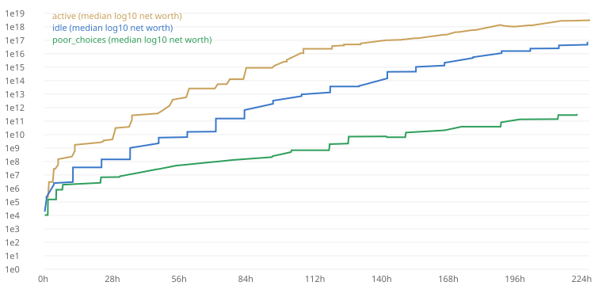

# Balance report

Commit `a68b2f8` · 3 bots × 3 seeds × 10 days · 3131.3 s on 4 threads

Runs: 9 · errors: 0

## Targets (median real time)

| Bot | Milestone | Target | p10 | p50 | p90 | Reached | Result |
|---|---|---|---|---|---|---|---|
| active | first_level | 0.0 m–1.0 m | 1.0 m | 1.0 m | 1.0 m | 3/3 | PASS |
| idle | first_level | 0.0 m–1.0 m | 1.0 m | 1.0 m | 1.0 m | 3/3 | PASS |
| active | first_manager | 5.0 m–8.0 m | 3.0 m | 7.0 m | 7.0 m | 3/3 | PASS |
| idle | first_manager | 5.0 m–15.0 m | 4.0 m | 10.0 m | 10.0 m | 3/3 | PASS |
| active | chapter1_done | 20.0 m–35.0 m | 21.0 m | 21.0 m | 21.0 m | 3/3 | PASS |
| idle | chapter1_done | 45.0 m–1.5 h | 1.0 h | 1.0 h | 1.0 h | 3/3 | PASS |
| active | chapter2_done | 3.0 h–6.0 h | 3.7 h | 3.9 h | 3.9 h | 3/3 | PASS |
| idle | chapter2_done | 8.0 h–16.0 h | 12.0 h | 12.0 h | 12.0 h | 3/3 | PASS |
| active | first_conglomerate | 18.0 h–2.0 d | 24.7 h | 28.4 h | 28.4 h | 3/3 | PASS |
| idle | first_conglomerate | 2.0 d–4.0 d | 2.5 d | 2.5 d | 2.5 d | 3/3 | PASS |
| active | chapter8_done | 5.0 d–6.0 d | 5.2 d | 6.0 d | 6.0 d | 3/3 | PASS |
| active | first_property | 20.0 m–1.5 h | 21.0 m | 22.0 m | 22.0 m | 3/3 | PASS |
| idle | first_property | 1.0 h–4.0 h | 1.0 h | 1.0 h | 1.0 h | 3/3 | PASS |
| active | first_auction_win | 12.0 h–2.0 d | 23.4 h | 29.6 h | 29.6 h | 3/3 | PASS |
| idle | first_auction_win | 2.0 d–3.0 d | 2.5 d | 3.0 d | 3.0 d | 3/3 | PASS |
| idle | chapter8_done | 8.0 d–10.0 d | 9.5 d | 9.5 d | 9.5 d | 1/3 | **FAIL** |
| poor_choices | chapter1_done | 0.0 m–24.0 h | 4.8 h | 4.9 h | 4.9 h | 3/3 | PASS |

## All milestones (p50, with p10–p90)

| Milestone | active | idle | poor_choices |
|---|---|---|---|
| first_level | 1.0 m (1.0 m–1.0 m) 3/3 | 1.0 m (1.0 m–1.0 m) 3/3 | 1.0 m (1.0 m–1.0 m) 3/3 |
| first_manager | 7.0 m (3.0 m–7.0 m) 3/3 | 10.0 m (4.0 m–10.0 m) 3/3 | 11.0 m (3.0 m–11.0 m) 3/3 |
| restaurant_open | 20.0 m (19.0 m–20.0 m) 3/3 | 1.0 h (1.0 h–1.0 h) 3/3 | 1.5 h (1.4 h–1.5 h) 3/3 |
| chapter1_done | 21.0 m (21.0 m–21.0 m) 3/3 | 1.0 h (1.0 h–1.0 h) 3/3 | 4.9 h (4.8 h–4.9 h) 3/3 |
| logistics_open | 1.7 h (1.3 h–1.7 h) 3/3 | 1.0 h (1.0 h–1.0 h) 3/3 | 31.8 h (23.8 h–31.8 h) 3/3 |
| networth_10k | 5.0 m (5.0 m–5.0 m) 3/3 | 6.0 m (6.0 m–6.0 m) 3/3 | 12.0 m (12.0 m–12.0 m) 3/3 |
| networth_1m | 1.7 h (1.3 h–1.7 h) 3/3 | 4.0 h (4.0 h–4.0 h) 3/3 | 4.9 h (4.8 h–4.9 h) 3/3 |
| hq_level_5 | 1.7 h (1.3 h–1.7 h) 3/3 | 4.0 h (1.0 h–4.0 h) 3/3 | 1.4 h (1.3 h–1.4 h) 3/3 |
| chapter2_done | 3.9 h (3.7 h–3.9 h) 3/3 | 12.0 h (12.0 h–12.0 h) 3/3 | — (—–—) 0/3 |
| networth_100m | 5.6 h (5.6 h–5.6 h) 3/3 | 24.0 h (24.0 h–24.0 h) 3/3 | 3.0 d (2.3 d–3.0 d) 3/3 |
| networth_10b | 29.5 h (28.4 h–29.5 h) 3/3 | 2.5 d (2.5 d–2.5 d) 3/3 | 6.0 d (5.3 d–6.0 d) 3/3 |
| chapter3_done | 12.6 h (11.6 h–12.6 h) 3/3 | 48.0 h (36.0 h–48.0 h) 3/3 | — (—–—) 0/3 |
| chapter4_done | 2.2 d (2.0 d–2.2 d) 3/3 | 4.0 d (3.5 d–4.0 d) 3/3 | — (—–—) 0/3 |
| chapter5_done | 3.5 d (3.5 d–3.5 d) 3/3 | 6.0 d (5.5 d–6.0 d) 3/3 | — (—–—) 0/3 |
| chapter6_done | 4.2 d (4.0 d–4.2 d) 3/3 | 7.5 d (7.0 d–7.5 d) 3/3 | — (—–—) 0/3 |
| chapter7_done | 5.0 d (4.5 d–5.0 d) 3/3 | 9.0 d (9.0 d–9.0 d) 3/3 | — (—–—) 0/3 |
| chapter8_done | 6.0 d (5.2 d–6.0 d) 3/3 | 9.5 d (9.5 d–9.5 d) 1/3 | — (—–—) 0/3 |
| first_conglomerate | 28.4 h (24.7 h–28.4 h) 3/3 | 2.5 d (2.5 d–2.5 d) 3/3 | — (—–—) 0/3 |
| holding_formed | 8.2 d (8.2 d–8.2 d) 3/3 | — (—–—) 0/3 | — (—–—) 0/3 |
| first_property | 22.0 m (21.0 m–22.0 m) 3/3 | 1.0 h (1.0 h–1.0 h) 3/3 | — (—–—) 0/3 |
| first_luxury | 3.9 h (3.7 h–3.9 h) 3/3 | 12.0 h (12.0 h–12.0 h) 3/3 | — (—–—) 0/3 |
| first_auction_win | 29.6 h (23.4 h–29.6 h) 3/3 | 3.0 d (2.5 d–3.0 d) 3/3 | — (—–—) 0/3 |
| fortune_entry | 29.5 h (23.5 h–29.5 h) 3/3 | 2.0 d (2.0 d–2.0 d) 3/3 | — (—–—) 0/3 |
| fortune_top10 | 2.5 d (2.5 d–2.5 d) 3/3 | 6.0 d (5.0 d–6.0 d) 3/3 | — (—–—) 0/3 |
| fortune_top | 3.5 d (3.2 d–3.5 d) 3/3 | — (—–—) 0/3 | — (—–—) 0/3 |

## Health

| Bot | Idle minutes | Idle before Chapter 8 | No-purchase minutes | Longest stall (p90) | Final net worth (p50) | Cash ÷ next cost (median sample) |
|---|---|---|---|---|---|---|
| active | 43.0% | 21.4% | 49.2% | 17.0 h | $3.53Qi | 3229924.39 |
| idle | 4.1% | 3.7% | 8.7% | 12.0 h | $76.4Qa | 17401.57 |
| poor_choices | 13.7% | 13.7% | 21.9% | 24.0 h | $312B | 12.13 |

Idle minute = a session minute with neither a purchase nor a meaningful decision (a card, trade, property or luxury move, auction bid, mechanic setting, merger, loan or tax choice; tapping, collecting, claiming rewards and automatic cash parking don't count). Idle before Chapter 8 counts only the story (bots never pass the crown, so later minutes measure a finished generation). No-purchase minute = no level, business, HQ or expansion bought (the metric used before 1.2). Stall = time without 1% net-worth growth.

## Income share from markets and property (median over seeds, income earned during that day)

| Bot | Day 1 | Day 3 | Day 7 | Target day 1 / 3 / 7 |
|---|---|---|---|---|
| active | -0.0% | 0.0% | 0.0% | 0–8% / 5–20% / 15–30% |
| idle | 0.0% | 0.0% | 0.0% | 0–8% / 5–20% / 15–30% |
| poor_choices | 0.0% | 0.0% | 0.0% | 0–8% / 5–20% / 15–30% |

Counts dividends, coupons, staking, rent and realised market and property gains (losses reduce it). The target bands are for markets alone; luxury arrives in Phase 8.

Spender gap: compare `heavy_spender` with `active` in the milestone table (target 25–40 % faster, never more than 2×).
